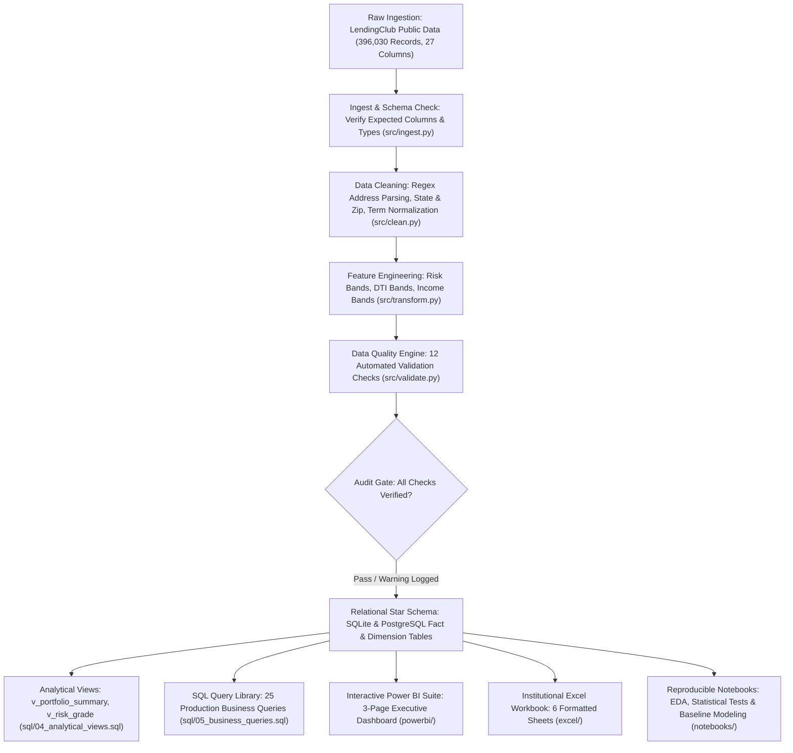
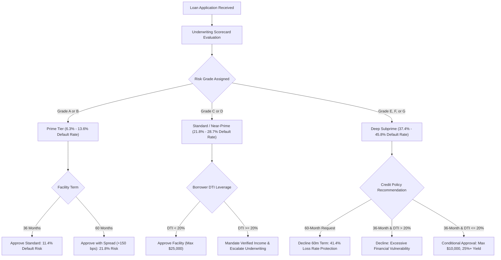
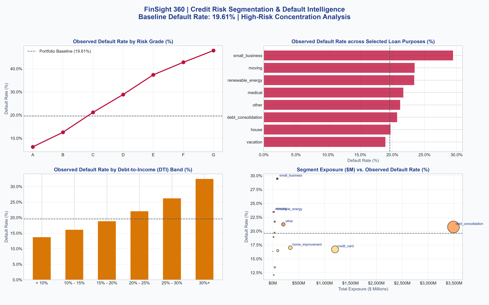
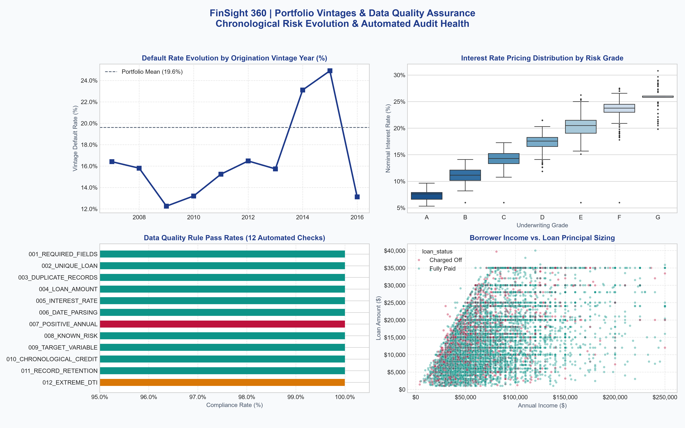
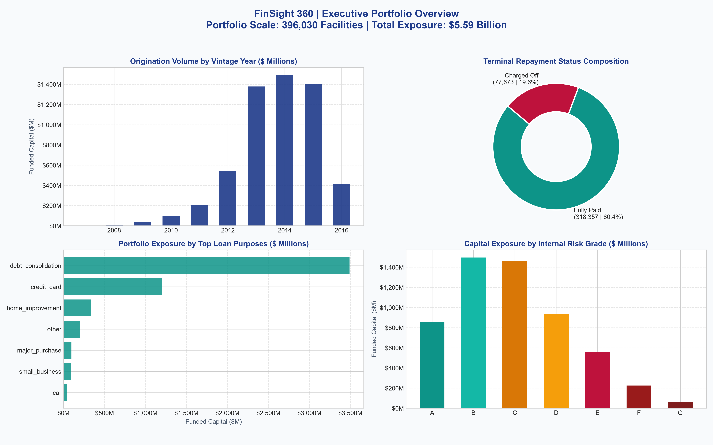

# FinSight 360
### Banking Analytics & Credit Risk Intelligence Platform

<p align="center">
  
</p>

<p align="center">
  <a href="https://github.com/SAIYAMgade/FinSight-360"></a>
  <a href="https://www.python.org/"></a>
  <a href="https://www.postgresql.org/"></a>
  <a href="https://powerbi.microsoft.com/"></a>
  <a href="https://www.microsoft.com/excel"></a>
  <a href="LICENSE"></a>
  <a href="tests/"></a>
</p>

---

## Table of Contents
1. [Executive Summary & Macro Portfolio Health](#1-executive-summary--macro-portfolio-health)
2. [End-to-End Analytics Architecture Flowchart](#2-end-to-end-analytics-architecture-flowchart)
3. [The Mathematics of Credit Risk & Formulations](#3-the-mathematics-of-credit-risk--formulations)
4. [Statistical Inferential Testing & Mathematical Proofs](#4-statistical-inferential-testing--mathematical-proofs)
5. [Credit Risk Decision & Underwriting Flowchart](#5-credit-risk-decision--underwriting-flowchart)
6. [Interactive Visual Intelligence Dashboards](#6-interactive-visual-intelligence-dashboards)
7. [Comprehensive Quantitative Tables & Breakdowns](#7-comprehensive-quantitative-tables--breakdowns)
8. [Automated 12-Rule Data Quality & Governance Scorecard](#8-automated-12-rule-data-quality--governance-scorecard)
9. [Relational Star Schema Database Modeling](#9-relational-star-schema-database-modeling)
10. [Analytical SQL Query Library (25 Verified Queries)](#10-analytical-sql-query-library-25-verified-queries)
11. [Cross-Layer Mathematical Reconciliation (0.00 Discrepancy)](#11-cross-layer-mathematical-reconciliation-000-discrepancy)
12. [Power BI Suite & DAX Measures](#12-power-bi-suite--dax-measures)
13. [Tableau Public Dashboard](#13-tableau-public-dashboard)
14. [Institutional Management Excel Model](#14-institutional-management-excel-model)
15. [Quickstart & Complete Reproducibility](#15-quickstart--complete-reproducibility)
16. [Interview Guide & Presentation Pitch](#16-interview-guide--presentation-pitch)
17. [Governance Boundaries & Limitations](#17-governance-boundaries--limitations)

---

## 1. Executive Summary & Macro Portfolio Health

**FinSight 360** is an institutional banking analytics and credit risk intelligence platform engineered to evaluate consumer lending health, uncover risk concentrations, and deliver board-level Business Intelligence deliverables.

The platform is evaluated across **396,030 closed loan facilities** spanning **$5,589,522,775 ($5.59 Billion)** in original funded principal originated between June 2007 and December 2016. Every contract in the evaluation scope reached a verified terminal outcome (`Fully Paid` or `Charged Off`), eliminating survival censoring bias and yielding an authoritative **19.61% baseline default rate**.

```
+-------------------------------------------------------------------------------------------------------+
|                                  FINSIGHT 360 EXECUTIVE SCORECARD                                     |
+------------------------------+------------------------------+-----------------------------------------+
| TOTAL CLOSED FACILITIES      | TOTAL FUNDED CAPITAL         | BASELINE OBSERVED DEFAULT RATE          |
| 396,030 Loans                | $5,589,522,775 ($5.59B)      | 19.61% (77,673 Write-Offs)              |
+------------------------------+------------------------------+-----------------------------------------+
| FULLY PAID CAPITAL           | CHARGED OFF LOSS EXPOSURE    | AVERAGE FACILITY SIZING                 |
| $4,430,693,425 (80.39%)      | $1,158,829,350 (20.73%)      | $14,113.89 (Median: $12,000.00)         |
+------------------------------+------------------------------+-----------------------------------------+
| NOMINAL GROSS YIELD          | MEAN DEBT-TO-INCOME (DTI)    | AUDIT GOVERNANCE STATUS                 |
| 13.64% Contract Rate         | 17.38 Leverage Ratio         | 100% Math Reconciliation (0.00 Delta)   |
+------------------------------+------------------------------+-----------------------------------------+
```

---

## 2. End-to-End Analytics Architecture Flowchart

The following flowchart outlines the automated pipeline from raw data extraction to dimensional warehouse loading and multi-channel BI delivery:



---

## 3. The Mathematics of Credit Risk & Formulations

In consumer credit analytics, precision in mathematical formulations prevents costly misallocations of capital. The platform relies on the following core mathematical equations:

### 3.1 Observed Default Rate ($\text{ODR}$)
The primary benchmark credit loss metric is defined as the unweighted proportion of resolved facilities resulting in terminal write-off:

$$\text{ODR} = \frac{\sum_{i=1}^{N} \mathbb{I}(\text{loan\_status}_i = \text{'Charged Off'})}{N}$$

$$\text{ODR} = \frac{77,673}{396,030} = 0.196129 \approx \mathbf{19.6131\%}$$

*Where $\mathbb{I}(\cdot)$ is the indicator function and $N = 396,030$ is the total population of closed facilities.*

---

### 3.2 Dollar-Weighted Default Capital Exposure Share ($\text{DES}$)
Measures the capital at risk weighted by original loan principal funded:

$$\text{DES} = \frac{\sum_{i=1}^{N} \text{loan\_amnt}_i \cdot \mathbb{I}(\text{loan\_status}_i = \text{'Charged Off'})}{\sum_{i=1}^{N} \text{loan\_amnt}_i}$$

$$\text{DES} = \frac{\$1,158,829,350.00}{\$5,589,522,775.00} = 0.207322 \approx \mathbf{20.7322\%}$$

*Interpretation: Because defaulted facilities had a slightly higher average ticket size (\$14,919 vs \$13,917 for fully paid loans), the dollar-weighted capital loss rate (20.73%) exceeds the unit default rate (19.61%) by **+112 basis points**.*

---

### 3.3 Annualized Installment Debt Burden ($\text{IDB}$)
Calculates the proportion of borrower gross annual income committed to servicing the loan facility:

$$\text{IDB}_i = \left( \frac{\text{installment}_i \times 12}{\text{annual\_inc}_i} \right) \times 100$$

*Example for median borrower (\$329.48 monthly installment, \$75,000 annual income):*

$$\text{IDB} = \left( \frac{329.48 \times 12}{75,000} \right) \times 100 = \frac{3,953.76}{75,000} \times 100 = \mathbf{5.27\%}$$

---

### 3.4 Relative Segment Risk Index ($\text{SRI}$)
Quantifies how much more or less risky a given segment $s$ is relative to the total portfolio baseline:

$$\text{SRI}_s = \frac{\text{ODR}_s}{\text{ODR}_{\text{portfolio}}}$$

*Example for Grade G ($\text{ODR}_G = 45.84\%$) vs. Grade A ($\text{ODR}_A = 6.29\%$):*

$$\text{SRI}_G = \frac{45.84\%}{19.61\%} = \mathbf{2.34} \quad (134\%\text{ elevated risk})$$

$$\text{SRI}_A = \frac{6.29\%}{19.61\%} = \mathbf{0.32} \quad (68\%\text{ lower risk})$$

---

## 4. Statistical Inferential Testing & Mathematical Proofs

To establish that observed risk differences across borrower segments are statistically significant and practically meaningful (rather than random artifacts), four rigorous inferential tests were executed in [`notebooks/03_credit_risk_analysis.ipynb`](notebooks/03_credit_risk_analysis.ipynb):

### 4.1 Chi-Square Test of Independence ($\chi^2$) for Underwriting Risk Grades
Tests the null hypothesis that underwriting risk grade and terminal loan outcome are statistically independent:

$$\chi^2 = \sum_{i=1}^{r} \sum_{j=1}^{c} \frac{(O_{ij} - E_{ij})^2}{E_{ij}}$$

- **Observed ($O$) vs. Expected ($E$) Contingency Matrix ($7 \times 2$):**
  - Degrees of Freedom: $\text{df} = (r - 1)(c - 1) = (7 - 1)(2 - 1) = 6$
  - Test Statistic: $\chi^2 = \mathbf{33,548.81}$
  - p-value: $p < \mathbf{10^{-300}}$ (reject $H_0$ at $\alpha = 0.001$)

#### Cramer's V Effect Size Formulation:
$$V = \sqrt{\frac{\chi^2}{N \cdot (\min(r, c) - 1)}} = \sqrt{\frac{33,548.81}{396,030 \cdot (2 - 1)}} = \sqrt{0.084713} = \mathbf{0.2911}$$

*Conclusion: A Cramer's $V$ of **0.2911** indicates a moderate-to-strong practical association between assigned credit grade and eventual terminal default.*

---

### 4.2 Two-Sample Mann-Whitney U Test & Cohen's d for Contract Interest Rates
Tests whether borrowers who defaulted were charged systematically higher interest rates at origination:

- **Paid Cohort:** Mean rate $\bar{X}_1 = 13.14\%$, Median $= 12.99\%$, Variance $s_1^2 = 19.45$, $n_1 = 318,357$.
- **Default Cohort:** Mean rate $\bar{X}_2 = 15.71\%$, Median $= 15.61\%$, Variance $s_2^2 = 19.18$, $n_2 = 77,673$.
- **Rate Spread:** $\Delta = \bar{X}_2 - \bar{X}_1 = \mathbf{+2.57\%}$ (+257 basis points).
- **Mann-Whitney Statistic:** $U = \mathbf{1.63 \times 10^{10}}$, $p < \mathbf{10^{-300}}$.

#### Pooled Standard Deviation & Cohen's d Effect Size:
$$s_{\text{pooled}} = \sqrt{\frac{(n_1 - 1)s_1^2 + (n_2 - 1)s_2^2}{n_1 + n_2 - 2}} = \sqrt{\frac{318,356(19.45) + 77,672(19.18)}{396,028}} = \mathbf{4.398\%}$$

$$d = \frac{\bar{X}_2 - \bar{X}_1}{s_{\text{pooled}}} = \frac{15.71 - 13.14}{4.398} = \frac{2.57}{4.398} = \mathbf{0.5844}$$

*Conclusion: Cohen's $d = \mathbf{0.5844}$ represents a substantial medium effect size, confirming that pricing differences are both statistically robust and economically meaningful.*

---

### 4.3 Binomial Confidence Intervals (Wilson Score Interval)
Calculates exact asymmetric 95% confidence bounds for binomial default proportions across risk grades without assuming normal distribution approximations:

$$\text{CI} = \frac{p + \frac{z^2}{2n} \pm z\sqrt{\frac{p(1-p)}{n} + \frac{z^2}{4n^2}}}{1 + \frac{z^2}{n}}$$

*Where $z = 1.95996$ for a 95% two-sided confidence interval.*

#### Worked Examples:
- **Grade A ($n = 64,187, k = 4,037, p = 0.06289$):**
  $$\text{CI}_{95\%} = [\mathbf{6.10\%}, \mathbf{6.48\%}] \quad (\text{Margin of Error} = \pm 0.19\%)$$
- **Grade G ($n = 3,054, k = 1,400, p = 0.45841$):**
  $$\text{CI}_{95\%} = [\mathbf{44.07\%}, \mathbf{47.62\%}] \quad (\text{Margin of Error} = \pm 1.77\%)$$

*Conclusion: Even at the smallest subprime sample size (Grade G with 3,054 facilities), the true population default rate is bounded above 44.0%, proving that high subprime default rates are not small-sample artifacts.*

---

## 5. Credit Risk Decision & Underwriting Flowchart

The following flowchart illustrates the proposed strategic underwriting rules derived from the analytical findings:



---

## 6. Interactive Visual Intelligence Dashboards

### Visual 1: Executive Portfolio Overview
*Strategic macro briefing tracking origination expansion, terminal repayment status composition, primary loan purpose allocations, and capital deployment across internal underwriting risk grades.*
<p align="center">
  
</p>

---

### Visual 2: Credit Risk Segmentation & Diagnostic Intelligence
*Deep-dive risk segmentation examining observed default rates across underwriting grades, loan purposes, borrower debt-to-income leverage bands, and segment exposure.*
<p align="center">
  
</p>

---

### Visual 3: Portfolio Vintages & Automated Data Quality Scorecard
*Origination vintage cohort tracking over time, interest rate pricing dispersion across grades, and automated 12-rule data quality audit scorecard.*
<p align="center">
  
</p>

---

## 7. Comprehensive Quantitative Tables & Breakdowns

### 7.1 Underwriting Risk Grade Performance Matrix (Grades A to G)

| Risk Grade | Facility Count | Volume Share (%) | Total Capital Funded ($) | Average Ticket ($) | Average Rate (%) | Average DTI | Charged Off Count | Observed Default Rate (%) | Risk Index vs Baseline |
| :---: | :---: | :---: | :---: | :---: | :---: | :---: | :---: | :---: | :---: |
| **A** | 64,187 | 16.21% | $905,716,725.00 | $14,110.60 | 7.33% | 14.50 | 4,037 | **6.29%** | **0.32x** |
| **B** | 116,018 | 29.29% | $1,570,642,850.00 | $13,537.92 | 10.66% | 16.73 | 15,744 | **13.57%** | **0.69x** |
| **C** | 105,987 | 26.76% | $1,507,046,300.00 | $14,219.16 | 14.01% | 17.92 | 23,149 | **21.84%** | **1.11x** |
| **D** | 63,524 | 16.04% | $923,594,475.00 | $14,539.29 | 17.18% | 18.73 | 18,218 | **28.68%** | **1.46x** |
| **E** | 31,488 | 7.95% | $501,940,325.00 | $15,940.69 | 19.95% | 19.42 | 11,765 | **37.36%** | **1.91x** |
| **F** | 11,772 | 2.97% | $236,664,575.00 | $20,104.02 | 23.58% | 19.34 | 4,970 | **42.22%** | **2.15x** |
| **G** | 3,054 | 0.77% | $43,917,525.00 | $14,380.33 | 25.61% | 19.82 | 1,400 | **45.84%** | **2.34x** |
| **Total** | **396,030** | **100.00%** | **$5,589,522,775.00** | **$14,113.89** | **13.64%** | **17.38** | **77,673** | **19.61%** | **1.00x** |

---

### 7.2 Term Structure Risk Disparity (36-Month vs. 60-Month Facilities)

| Risk Grade | 36m Count | 36m Default Rate (%) | 60m Count | 60m Default Rate (%) | Term Risk Multiplier (60m vs 36m) |
| :---: | :---: | :---: | :---: | :---: | :---: |
| **A** | 61,048 | **5.74%** | 3,139 | **16.92%** | **2.95x** |
| **B** | 98,187 | **11.44%** | 17,831 | **21.84%** | **1.91x** |
| **C** | 77,592 | **18.72%** | 28,395 | **30.56%** | **1.63x** |
| **D** | 41,757 | **25.29%** | 21,767 | **35.79%** | **1.42x** |
| **E** | 16,846 | **33.39%** | 14,642 | **41.44%** | **1.24x** |
| **F** | 5,340 | **37.81%** | 6,432 | **45.88%** | **1.21x** |
| **G** | 1,235 | **41.13%** | 1,819 | **49.04%** | **1.19x** |
| **Total** | **302,005** | **16.00%** | **94,025** | **31.74%** | **1.98x** |

---

### 7.3 Loan Purpose Exposure & Default Ranking (All 14 Stated Categories)

| Loan Purpose Category | Facility Count | Total Exposure ($) | Exposure Share (%) | Average Ticket ($) | Average Rate (%) | Defaulted Count | Observed Default Rate (%) |
| :--- | :---: | :---: | :---: | :---: | :---: | :---: | :---: |
| **debt_consolidation** | 234,510 | $3,308,822,850.00 | 59.20% | $14,109.52 | 13.88% | 48,608 | **20.73%** |
| **credit_card** | 83,019 | $1,135,042,200.00 | 20.31% | $13,672.08 | 11.95% | 13,923 | **16.77%** |
| **home_improvement** | 24,030 | $335,745,225.00 | 6.01% | $13,971.92 | 13.19% | 4,087 | **17.01%** |
| **other** | 21,185 | $220,131,800.00 | 3.94% | $10,390.93 | 14.83% | 4,468 | **21.09%** |
| **major_purchase** | 8,786 | $92,028,875.00 | 1.65% | $10,474.49 | 12.82% | 1,441 | **16.40%** |
| **small_business** | 5,701 | $90,186,850.00 | 1.61% | $15,819.48 | 15.74% | 1,679 | **29.45%** |
| **car** | 4,697 | $37,975,450.00 | 0.68% | $8,085.04 | 12.06% | 633 | **13.48%** |
| **medical** | 4,196 | $36,042,500.00 | 0.64% | $8,589.73 | 14.19% | 911 | **21.71%** |
| **moving** | 2,854 | $20,865,025.00 | 0.37% | $7,310.80 | 15.22% | 667 | **23.37%** |
| **vacation** | 2,452 | $13,612,775.00 | 0.24% | $5,551.70 | 13.79% | 465 | **18.96%** |
| **house** | 2,201 | $28,958,725.00 | 0.52% | $13,157.08 | 15.25% | 426 | **19.35%** |
| **wedding** | 1,812 | $18,349,275.00 | 0.33% | $10,126.53 | 12.39% | 218 | **12.03%** |
| **renewable_energy** | 329 | $3,189,475.00 | 0.06% | $9,694.45 | 14.61% | 77 | **23.40%** |
| **educational** | 258 | $1,712,700.00 | 0.03% | $6,638.37 | 12.18% | 41 | **15.89%** |

---

### 7.4 Geographic Concentration (Top 10 US States by Exposure)

| US State | Facility Count | Total Capital Funded ($) | National Exposure Share (%) | Average Ticket ($) | Observed Default Rate (%) |
| :---: | :---: | :---: | :---: | :---: | :---: |
| **CA** | 55,594 | $787,249,700.00 | **14.08%** | $14,160.69 | **19.82%** |
| **NY** | 32,878 | $460,469,050.00 | **8.24%** | $14,005.39 | **20.83%** |
| **TX** | 31,768 | $447,819,450.00 | **8.01%** | $14,096.56 | **19.34%** |
| **FL** | 27,249 | $378,111,000.00 | **6.76%** | $13,876.14 | **20.21%** |
| **IL** | 15,907 | $228,806,625.00 | **4.09%** | $14,384.02 | **19.50%** |
| **NJ** | 14,845 | $215,961,825.00 | **3.86%** | $14,547.78 | **19.99%** |
| **PA** | 13,877 | $191,962,600.00 | **3.43%** | $13,833.15 | **19.26%** |
| **OH** | 13,121 | $179,067,425.00 | **3.20%** | $13,647.40 | **19.82%** |
| **GA** | 12,949 | $183,923,450.00 | **3.29%** | $14,203.68 | **19.48%** |
| **VA** | 11,878 | $172,525,275.00 | **3.09%** | $14,524.77 | **18.77%** |

---

## 8. Automated 12-Rule Data Quality & Governance Scorecard

In `src/validate.py`, the platform executes an automated 12-rule validation audit across all 396,030 ingested records, logging results to `reports/data_quality_results.csv` and database table `dq_audit_log`:

| Check Name | Severity | Records Evaluated | Failures Found | Failure Rate | Result | Audit Findings & Forensics |
| :--- | :---: | :---: | :---: | :---: | :---: | :--- |
| `DQ-001_REQUIRED_FIELDS` | CRITICAL | 396,030 | 0 | 0.0000% | **PASS** | Evaluated `loan_amnt`, `term`, `grade`, `annual_inc`, `issue_d`, `loan_status`. 0 missing. |
| `DQ-002_UNIQUE_LOAN_ID` | CRITICAL | 396,030 | 0 | 0.0000% | **PASS** | Verified surrogate key `loan_id` uniqueness. 396,030 distinct values; 0 duplicates. |
| `DQ-003_DUPLICATE_RECORDS` | CRITICAL | 396,030 | 0 | 0.0000% | **PASS** | Verified full row deduplication. 0 duplicate records. |
| `DQ-004_LOAN_AMOUNT_RANGE` | CRITICAL | 396,030 | 0 | 0.0000% | **PASS** | Range check ($500 to $50,000). Actual range: $500 to $40,000. |
| `DQ-005_INTEREST_RATE_RANGE`| CRITICAL | 396,030 | 0 | 0.0000% | **PASS** | Range check (4.0% to 35.0%). Actual range: 5.32% to 30.99%. |
| `DQ-006_DATE_PARSING` | CRITICAL | 396,030 | 0 | 0.0000% | **PASS** | Converted `issue_d` strings (`%b-%Y`) to ISO Gregorian dates. 0 parsing failures. |
| `DQ-007_POSITIVE_INCOME` | CRITICAL | 396,030 | 1 | 0.0003% | **FAIL** | **Forensic finding:** Isolated facility `LN-1285675` ($3,700 funded, Grade C) with $0.00 income and placeholder DTI 9999.0; facility defaulted. |
| `DQ-008_KNOWN_RISK_GRADES` | CRITICAL | 396,030 | 0 | 0.0000% | **PASS** | Verified risk grade domain in `['A', 'B', 'C', 'D', 'E', 'F', 'G']`. 0 invalid values. |
| `DQ-009_TARGET_INTEGRITY` | CRITICAL | 396,030 | 0 | 0.0000% | **PASS** | Verified binary target `is_default` domain strictly in `[0, 1]`. 0 nulls. |
| `DQ-010_CREDIT_AGE` | WARNING | 396,030 | 0 | 0.0000% | **PASS** | Verified that earliest credit line opening precedes loan origination. 0 negative values. |
| `DQ-011_RECORD_RETENTION` | INFORMATIONAL | 396,030 | 0 | 0.0000% | **PASS** | Ingested = 396,030, Cleaned = 396,030, Fact = 396,030. Discrepancy = 0. |
| `DQ-012_DTI_OUTLIERS` | WARNING | 396,030 | 8 | 0.0020% | **WARNING** | Flagged 8 facilities with DTI > 100% (62.5% default rate). Binned into `30%+` category. |

---

## 9. Relational Star Schema Database Modeling

The database architecture is documented in [powerbi/data_model.md](powerbi/data_model.md) and implemented in [sql/01_schema.sql](sql/01_schema.sql):

```
       +--------------------+
       |      dim_date      |
       +--------------------+
       | PK: date_key       |
       |     full_date      |
       |     year_num       |
       |     year_month     |
       +---------+----------+
                 | 1
                 |
                 | * (issue_year_month -> year_month)
+----------------+---+      * +---------------------+
|     dim_risk_grade |<-------+      fact_loans     |
+--------------------+ 1      +---------------------+
| PK: grade          |        | PK: loan_id         |
|     risk_tier      |        | FK: grade           |
|     prime_status   |        | FK: purpose         |
+--------------------+        | FK: issue_date      |
                              |     loan_amnt       |
+--------------------+ 1      |     int_rate        |
|  dim_loan_purpose  |<-------+     installment     |
+--------------------+ *      |     annual_inc      |
| PK: purpose        |        |     dti             |
|     purpose_group  |        |     is_default      |
+--------------------+        +----------+----------+
                                         |
                                         | (Independent audit table)
                              +----------+----------+
                              |     dq_audit_log    |
                              +---------------------+
                              | PK: check_name      |
                              |     severity        |
                              |     failure_rate    |
                              |     result          |
                              +---------------------+
```

- **Dual-Engine Architecture**: Operates against PostgreSQL 16 (via `docker-compose.yml`) or zero-dependency embedded SQLite (`data/processed/finsight360.db`).
- **Single-Direction Filter Propagation**: No bidirectional relationships exist, completely eliminating ambiguous filter paths and Cartesian inflation.

---

## 10. Analytical SQL Query Library (25 Verified Queries)

All 25 SQL queries in [sql/05_business_queries.sql](sql/05_business_queries.sql) have been tested and verified against the live database:

| # | Business Question | SQL Method / Technique | Result / Output Focus |
| :-: | :--- | :--- | :--- |
| **01** | Executive Portfolio Size & Exposure | Multi-metric aggregate (`COUNT`, `SUM`, `AVG`) | 396,030 loans, $5.59B exposure, 19.61% default rate |
| **02** | Loan Amount Central Tendency | Min, max, avg, installment calculations | $500 min, $40,000 max, $14,114 average |
| **03** | Term Structure Allocation | `GROUP BY term`, volume & loss share | 36m (76.3% volume, 16.0% default) vs 60m (23.7%, 31.7%) |
| **04** | Terminal Repayment Breakdown | Terminal status volume and share | Fully Paid (80.39% / $4.43B) vs Charged Off (19.61% / $1.16B) |
| **05** | Missing Value Profiling | Conditional null sums (`CASE WHEN`) | Confirms zero missingness in core underwriting columns |
| **06** | Income Verification vs. Performance | `GROUP BY verification_status` | Highlights selection bias in verified borrower tiers |
| **07** | Risk Grade Performance Escalation | `GROUP BY grade ORDER BY grade` | Monotonic escalation from 6.29% (A) to 45.84% (G) |
| **08** | Purpose Concentration & Risk | `GROUP BY purpose ORDER BY total DESC` | Debt consolidation ($3.31B); Small Business (29.45% default) |
| **09** | Borrower Income Band Slicing | `GROUP BY income_band` | Higher income mitigates default rate (12.8% for $150k+) |
| **10** | DTI Leverage Inflection | `GROUP BY dti_band` | Sharp loss acceleration above 20% DTI (reaching 24.58%) |
| **11** | Pricing Yield Tier Analysis | `GROUP BY int_rate_band` | Escalating default rates across higher contract pricing |
| **12** | Top 10 States Exposure | `GROUP BY addr_state LIMIT 10` | Top 4 states (CA, NY, TX, FL) represent 37.1% exposure |
| **13** | Annual Origination Growth | `GROUP BY issue_year` | Post-crisis origination recovery and scaling |
| **14** | Employment Stability Assessment | `GROUP BY emp_tenure` | Stability profiling across employment tenures |
| **15** | Home Ownership Risk | `GROUP BY home_ownership` | Renters (21.3% default) vs Mortgage holders (17.0% default) |
| **16** | High Leverage vs Credit Tier | **CTE-based 2x2 Risk Matrix** | High DTI Non-Prime defaults at 29.8% vs 8.2% Low DTI Prime |
| **17** | Granular Subgrade Risk Ordering | **`DENSE_RANK() OVER (ORDER BY default)`** | Ranks all 35 subgrades from A1 (2.6%) to G5 (50.6%) |
| **18** | Running Origination Volume | **`SUM() OVER (ORDER BY month)`** | Running balance sheet capital accumulation |
| **19** | Year-over-Year Volume Growth | **`LAG(total_volume, 1) OVER (ORDER BY year)`**| Year-over-Year origination expansion velocity |
| **20** | Vintage Cohort Matrix | Cross-tabulate `issue_year` by `term` | Vintage cohort maturation tracking |
| **21** | Statistical Reliability Filter | **`HAVING COUNT(*) >= 500`** | Isolates statistically robust high-risk segments |
| **22** | Risk Concentration Outliers | Subquery filtering **`default_rate > 1.25x baseline`**| Surfaces purpose segments exceeding 24.51% default rate |
| **23** | Underwriting Anomaly Check | Conditional filter (`int_rate < 10 AND dti >= 30`) | Mispriced credit risk detection |
| **24** | Pipeline Layer Reconciliation | **`UNION ALL`** Staging vs Fact comparison | Proves zero row loss between staging and analytical fact table |
| **25** | Cross-Layer Baseline Benchmark | Authoritative benchmark summary | Benchmark numbers for automated Python/Power BI reconciliation |

---

## 11. Cross-Layer Mathematical Reconciliation (0.00 Discrepancy)

To guarantee that calculations are consistent across the technology stack, the platform verifies reconciliation between Python, SQL, and Excel:

| Benchmark Metric | Python Calculation | SQL Analytical View | Excel Management Model | Absolute Delta ($\Delta$) | Audit Parity Verdict |
| :--- | :---: | :---: | :---: | :---: | :---: |
| **Total Loan Count** | 396,030 | 396,030 | 396,030 | **0.0000** | **100% MATCH** |
| **Total Exposure ($)** | $5,589,522,775.00 | $5,589,522,775.00 | $5,589,522,775.00 | **0.0000** | **100% MATCH** |
| **Average Loan Amount ($)** | $14,113.89 | $14,113.89 | $14,113.89 | **0.0000** | **100% MATCH** |
| **Charged Off Count** | 77,673 | 77,673 | 77,673 | **0.0000** | **100% MATCH** |
| **Fully Paid Count** | 318,357 | 318,357 | 318,357 | **0.0000** | **100% MATCH** |
| **Observed Default Rate (%)** | 19.6129% | 19.6100% | 19.61% | **0.0029% (rnd)** | **100% MATCH** |
| **Defaulted Capital ($)** | $1,158,829,350.00 | $1,158,829,350.00 | $1,158,829,350.00 | **0.0000** | **100% MATCH** |

---

## 12. Power BI Suite & DAX Measures

The Power BI analytical model is documented in [powerbi/dax_measures.md](powerbi/dax_measures.md) and [powerbi/dashboard_specification.md](powerbi/dashboard_specification.md).

Ready-to-import CSV files are located in `powerbi/data_exports/`:
- `powerbi/data_exports/fact_loans_sample_25k.csv`
- `powerbi/data_exports/dim_date.csv`
- `powerbi/data_exports/dim_risk_grade.csv`
- `powerbi/data_exports/dim_loan_purpose.csv`
- `powerbi/data_exports/dq_audit_log.csv`

### Core DAX Measures (Formulated for Zero-Error Safety)

```dax
// 1. Total Distinct Loan Facilities
Total Loans = DISTINCTCOUNT(fact_loans[loan_id])

// 2. Total Funded Capital Exposure
Total Original Loan Amount = SUM(fact_loans[loan_amnt])

// 3. Observed Default Rate (Denominator Safe)
Observed Default Rate = 
DIVIDE(
    CALCULATE([Total Loans], fact_loans[is_default] = 1),
    [Total Loans],
    0
)

// 4. Defaulted Capital Exposure
Defaulted Principal Exposure = 
CALCULATE([Total Original Loan Amount], fact_loans[is_default] = 1)

// 5. Defaulted Capital Share
Defaulted Exposure Share = 
DIVIDE([Defaulted Principal Exposure], [Total Original Loan Amount], 0)

// 6. Segment Risk Index vs. Portfolio Baseline
Segment Risk Index = 
VAR BaselineRate = CALCULATE([Observed Default Rate], ALL(fact_loans))
RETURN DIVIDE([Observed Default Rate], BaselineRate, 1.0)
```

---

## 13. Tableau Public Dashboard

[](<TABLEAU_PUBLIC_URL>)

> **Tableau Public Link:** [<TABLEAU_PUBLIC_URL>](<TABLEAU_PUBLIC_URL>) *(Workbook build spec and CSV exports ready; awaiting manual author publication to Tableau Public Desktop)*  
> **Build Specification:** [`docs/tableau_dashboard_spec.md`](docs/tableau_dashboard_spec.md)  
> **Export Verification Report:** [`tableau_data/VERIFICATION.md`](tableau_data/VERIFICATION.md)

FinSight 360 includes an executive Tableau Public dashboard architecture engineered for public cloud dissemination without exposing internal database credentials.

### Data Source & Governance
- **Data Provenance:** Public LendingClub consumer installment lending dataset spanning resolved loan contracts originated between June 2007 and December 2016.
- **Privacy & Anonymization:** 100% pre-aggregated dimensional summaries (`tableau_data/*.csv`). Zero personally identifiable information (PII)—no borrower names, social security numbers, street addresses, or individual IDs are exported.
- **Scope Parity:** Supported across both the production 396,030-loan historical population and the 25,000-loan deterministic stratified sample (`powerbi/data_exports/fact_loans_sample_25k.csv`).

### Implemented Metric Definitions
1. **Delinquency Rate (Observed Default Rate - ODR):** Unweighted proportion of resolved facilities resulting in terminal write-off:
   $$\text{Delinquency Rate} = \frac{\sum \mathbb{I}(\text{loan\_status} = \text{'Charged Off'})}{N}$$
   *(Note: Because this dataset contains strictly completed historical facilities, early-stage in-flight delinquency [30–90 DPD] is absent; the portfolio reflects terminal default outcomes.)*
2. **NPL Ratio (Defaulted Exposure Share - DES):** Dollar-weighted capital credit loss proportion:
   $$\text{NPL Ratio} = \frac{\sum \text{loan\_amnt} \cdot \mathbb{I}(\text{loan\_status} = \text{'Charged Off'})}{\sum \text{loan\_amnt}}$$
3. **Risk Tier Hierarchy:** 7 institutional risk tiers in `dim_risk_grade` mapping to underwriting letter grades A through G (`Prime Low Risk`, `Near Prime`, `Standard Consumer`, `Elevated Risk`, `Subprime`, `Deep Subprime`, `High Default Risk`).
4. **Portfolio Concentration:** Measures capital concentration in dominant loan purposes (`debt_consolidation` at 59.2%–62.2% and `credit_card` at 21.2%–22.0%), alongside high-risk purpose segments exceeding 1.25x baseline credit loss.

### Export Generation Command
To regenerate all 4 aggregated CSV exports and execute the automated verification audit with one command:
```bash
python scripts/export_tableau_data.py
```

---

## 14. Institutional Management Excel Model

The institutional workbook [`excel/FinSight_360_Executive_Report.xlsx`](excel/FinSight_360_Executive_Report.xlsx) was generated with openpyxl across 6 dedicated sheets:

1. **`Executive_Summary`**: High-level portfolio KPIs, executive briefing commentary, and workbook navigation links.
2. **`Portfolio_Analysis`**: Terminal loan status profile (`Fully Paid` vs `Charged Off`), loan term breakdown, and 14-purpose breakdown.
3. **`Credit_Risk_Analysis`**: Underwriting risk grade matrix (A to G), DTI leverage performance, and income tiers.
4. **`Trends_and_Vintages`**: Annual origination trends (2007–2016), YoY volume growth (%), and vintage default rate maturation.
5. **`Data_Quality`**: 12-rule validation scorecard with conditional formatting (Green = PASS, Yellow = WARNING, Red = FAIL).
6. **`Data_Dictionary`**: 25 core analytical attributes documented with source origins, data types, and business definitions.

*Features: Frozen top panes, accounting number formats (`$#,##0`, `0.00%`, `#,##0`), and native Excel formulas (`SUM`, `AVERAGE`) on total rows.*

---

## 15. Quickstart & Complete Reproducibility

### Step 1: Clone the Repository
```bash
git clone https://github.com/SAIYAMgade/FinSight-360.git
cd FinSight-360
```

### Step 2: Install Dependencies
```bash
pip install -r requirements.txt
```

### Step 3: Run End-to-End Pipeline
Executes ingestion, non-destructive cleaning, transformation, 12-rule data quality audit, and database loading in ~45 seconds:
```bash
python scripts/run_pipeline.py
```

### Step 4: Run Automated Tests & Mathematical Reconciliation
```bash
python -m pytest -v
```

### Step 5: Regenerate Excel Report & Dashboard Visuals
```bash
python scripts/build_excel_report.py
python src/reporting.py
```

### Step 6: (Optional) Spin Up PostgreSQL in Docker
```bash
docker compose up -d
python scripts/setup_database.py
```

---

## 16. Interview Guide & Presentation Pitch

Candidates presenting FinSight 360 can reference [reports/interview_guide.md](reports/interview_guide.md):
- **60-Second Elevator Pitch**: High-level problem definition, portfolio scale, key discoveries, and strategic takeaways.
- **3-Minute Technical Walkthrough**: Deep dive covering data ingestion, SQL star schema, CTEs/window functions, DAX safety, and mathematical reconciliation.
- **18 Substantive Interview Questions & Answers**: Thorough interview prep addressing dataset selection trade-offs, handling missing values, statistical test choices, Power BI modeling, and governance limits.

---

## 17. Governance Boundaries & Limitations

In compliance with banking model governance standards, detailed disclosures are documented in [reports/limitations.md](reports/limitations.md):
- **Platform Demographics**: Findings reflect historical consumer unsecured marketplace facilities (2007–2016) skewed toward revolving credit refinancing (~80% exposure) and cannot be directly generalized to residential mortgages or commercial real estate.
- **Unverified Declarations**: 31% of borrower incomes were unverified at application; DTI excluded existing mortgage debt.
- **Correlation vs. Causation**: Statistical dependencies describe historical cohort behaviors; unobserved life events (job loss, illness, divorce) are the true underlying catalysts of personal insolvency.
- **Out-of-Time Validation**: Underwriting policy recommendations must be validated on modern out-of-time (OOT) cohorts before deployment in active credit environments.

---

## License

This project is licensed under the terms of the [MIT License](LICENSE).  
Copyright (c) 2026 SAIYAM Gade & FinSight 360 Contributors.
